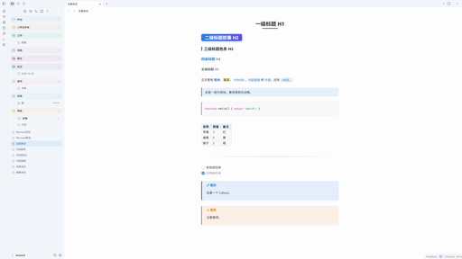

# Hidontknow

English | [简体中文](README.zh-CN.md)

A clean Obsidian theme with light and dark modes, built so that **reading view and editing view look the same**. The heading styles draw on [Phycat](https://github.com/sumruler/obsidian-theme-phycat), and the colors and components draw on [Blue Topaz](https://github.com/whyt-byte/Blue-Topaz_Obsidian-css). The file explorer styles are adapted from Phycat (MIT); everything else is original.

Requires Obsidian 1.14.0 or later.



## Reading view = editing view

This is the main feature of the theme. Switching between reading view and editing view (Live Preview) does not move or restyle your content: every line of text sits at the same position, with the same size, weight, color and background.

- **What is aligned**: headings (including the H2 pill height), paragraph and block spacing, list and task indents, bullets and checkboxes, blockquotes (including nested ones and long wrapped lines), code blocks (frame, font size, line height and indentation), tables, callouts, horizontal rules, images, embeds, math and the properties block.
- **How it is checked**: a script measures both views of the same note element by element. Positions match to within 0.05px in light and dark mode, at font sizes 14–20 and tab indent sizes 2, 4 and 8. Clicking in the editor still places the cursor exactly where you click.
- **Fixed by the support plugin**: a few differences come from how Obsidian's editor parses Markdown, and CSS cannot change them. The [Hidontknow Support](https://github.com/hidontknow/obsidian-theme-hidontknow-support) plugin fixes them in the editor:
  - Lists inside blockquotes: bullets, numbers, checkboxes and list spacing.
  - Code blocks nested in a list: indented to the list text, box included.
  - Footnotes: `[^1]` shows as `[1]`, and definitions at the end of the note show as a footnote section.
  - `%%comments%%`: hidden like in reading view.
  - Ordered lists: renumbered like in reading view (a `10.` after `3.` becomes `4.`).
  - Code highlighting: the editor is highlighted with reading view's Prism, so colors and styles match character by character. Without the plugin, the two views use different highlighters (Prism and CodeMirror) and keep Obsidian's default colors.
- **What still cannot match**, even with the plugin:
  - Footnote definitions in the middle of a note: reading view moves them to the end.

## Features

- **Headings**: H1 is centered with a gradient underline that grows on hover. H2 is a gradient pill. H3 has a colored bar on the left. H4 uses the accent color. Long H2 headings stay one pill when they wrap.
- **Text**: Bold text and inline code use the accent color. Blockquotes have a tinted background. Code blocks have an accent bar on the left. Tables have rounded corners and striped rows. Horizontal rules use a gradient.
- **File explorer**: Rounded rows, rainbow folders (top-level folders cycle through 7 colors) and thin indent guides. File icons show the file type: notes, images, PDF, audio, video, code, Office documents / spreadsheets / presentations, archives, Canvas, Base and Excalidraw. Files and folders line up.
- **Other**: Tags are pills, external links have no trailing arrow icon, callouts have a colored bar on the left, and completed tasks are dimmed.
- Respects the system "reduce motion" setting.

## Installation

Search for **Hidontknow** in **Settings → Appearance → Themes → Manage** (once the theme is listed in the theme directory).

Manual installation:

1. Create a folder named `Hidontknow` in your vault's `.obsidian/themes/` folder.
2. Copy `theme.css` and `manifest.json` into it.
3. Open **Settings → Appearance → Themes** and select **Hidontknow**.

## Changing the accent color

The accent color comes from `--accent-h/s/l`, and the theme sets separate defaults for light and dark mode. To use another color, add a CSS snippet:

```css
.theme-light { --accent-h: 340; --accent-s: 75%; --accent-l: 55%; }
.theme-dark  { --accent-h: 340; --accent-s: 70%; --accent-l: 65%; }
```

In dark mode the H2 pill uses dark text, so keep the dark `--accent-l` at 60% or higher.

## Companion plugin: Pele Mermaid (experimental)

The [Pele Mermaid](https://github.com/hidontknow/obsidian-pele-mermaid) plugin renders Mermaid diagrams with [Pele](https://github.com/obsidianmd/pele) instead of the built-in mermaid.js. The theme colors Pele diagrams for light and dark mode. Without the plugin, Mermaid diagrams are rendered by mermaid.js as usual.

## Development

```bash
npm install
npm run lint
```

## Credits

- [Blue Topaz](https://github.com/whyt-byte/Blue-Topaz_Obsidian-css), MIT, © whyt-byte
- [Phycat](https://github.com/sumruler/obsidian-theme-phycat), MIT, © XuJilong

## License

[MIT](LICENSE) © hidontknow. The file explorer styles are adapted from Phycat (MIT) and the file explorer icons come from [Lucide](https://lucide.dev) (ISC). See [THIRD-PARTY-NOTICES.md](THIRD-PARTY-NOTICES.md) for their licenses.
