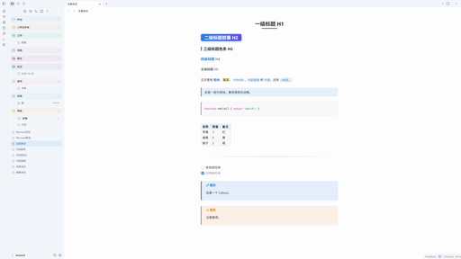

# Hidontknow

[English](README.md) | 简体中文

一款简洁的 Obsidian 主题，支持亮色 / 暗色，最大的特点是**阅读模式和编辑模式完全一致**。设计参考了 [Phycat](https://github.com/sumruler/obsidian-theme-phycat) 的标题装饰和 [Blue Topaz](https://github.com/whyt-byte/Blue-Topaz_Obsidian-css) 的配色与组件风格，文件列表样式改编自 Phycat（MIT），其余为原创实现。

需要 Obsidian 1.14.0 及以上。



## 阅读模式 = 编辑模式

这是本主题的核心特点。在阅读模式和编辑模式（实时预览）之间切换时，内容不会移动，样式也不会变：每一行文字的位置、字号、字重、颜色和背景都相同。

- **对齐的内容**：标题（包括 H2 胶囊的高度）、段落和块间距、列表与任务的缩进、圆点和复选框、引用块（包括嵌套引用和换行的长引用）、代码块（外框、字号、行高和缩进）、表格、Callout、分割线、图片、嵌入、公式和属性区。
- **怎么验证的**：用脚本对同一篇笔记逐个元素测量两种模式。亮色和暗色下、字号 14–20、Tab 缩进宽度 2 / 4 / 8，位置偏差都在 0.05px 以内。编辑时点击定位仍然准确。
- **由辅助插件补齐**：下面几处差异来自 Obsidian 编辑器解析 Markdown 的方式，CSS 改不了，装上 [Hidontknow Support](https://github.com/hidontknow/obsidian-theme-hidontknow-support) 插件后在编辑模式里补齐：
  - 引用里的列表：圆点、序号、复选框和列表间距。
  - 列表里的代码块：连同外框缩进到列表文字处。
  - 脚注：`[^1]` 显示为 `[1]`，文末的脚注定义显示成脚注区。
  - 注释 `%%…%%`：和阅读模式一样隐藏。
  - 有序列表：和阅读模式一样重新编号（`3.` 后面的 `10.` 显示为 `4.`）。
  - 代码高亮：编辑模式也用阅读模式的 Prism 上色，颜色和样式逐字一致。不装插件时两种模式用不同的高亮引擎（Prism 和 CodeMirror），保持 Obsidian 默认配色。
- **装了插件仍无法一致的地方**：
  - 写在正文中间的脚注定义：阅读模式会把它挪到文末。

## 特性

- **标题**：H1 居中，带渐变下划线（悬停变长）；H2 渐变胶囊；H3 左侧色条；H4 强调色。长标题换行后仍是完整的胶囊。
- **正文**：粗体为强调色，引用块有浅色背景，行内代码为强调色，代码块左侧带色条，表格圆角并隔行变色，分割线为渐变。
- **文件列表**：沿用 Phycat 样式，圆角标题行、彩虹文件夹（顶层文件夹按 7 色轮换）、细层级线；文件图标按类型区分（笔记、图片、PDF、音频、视频、代码、Office 文档 / 表格 / 演示、压缩包、Canvas、Base、Excalidraw），文件与文件夹文字对齐。
- **其他**：标签做成胶囊样式，外链不显示末尾箭头图标，Callout 左侧带色条，已完成的任务文字变淡。
- 尊重系统的「减少动态效果」设置。

## 安装

在 **设置 → 外观 → 主题 → 管理** 中搜索 **Hidontknow** 安装（需主题商店收录后）。

手动安装：

1. 在库的 `.obsidian/themes/` 下新建文件夹 `Hidontknow`。
2. 把 `theme.css` 和 `manifest.json` 复制进去（开发时可以用软链接）。
3. 打开 **设置 → 外观 → 主题**，选择 **Hidontknow**。

## 改色

强调色由 `--accent-h/s/l` 推导，主题为亮色和暗色分别设了默认值。想换颜色，可以新建一个 CSS 片段：

```css
.theme-light { --accent-h: 340; --accent-s: 75%; --accent-l: 55%; }
.theme-dark  { --accent-h: 340; --accent-s: 70%; --accent-l: 65%; }
```

暗色下 H2 胶囊用深色文字，所以暗色的 `--accent-l` 建议保持在 60% 以上。

## 配套插件：Pele Mermaid（试验）

插件 [Pele Mermaid](https://github.com/hidontknow/obsidian-pele-mermaid) 用 [Pele](https://github.com/obsidianmd/pele) 代替内置的 mermaid.js 渲染 Mermaid 图。主题已为 Pele 的图适配亮色 / 暗色配色；不装插件时，Mermaid 图照常由 mermaid.js 渲染。

## 开发

```bash
npm install
npm run lint
```

## 致谢

- [Blue Topaz](https://github.com/whyt-byte/Blue-Topaz_Obsidian-css)，MIT，© whyt-byte
- [Phycat](https://github.com/sumruler/obsidian-theme-phycat)，MIT，© XuJilong

## 许可

[MIT](LICENSE) © hidontknow。文件列表样式改编自 Phycat（MIT），文件列表图标来自 [Lucide](https://lucide.dev)（ISC），许可声明见 [THIRD-PARTY-NOTICES.md](THIRD-PARTY-NOTICES.md)。
